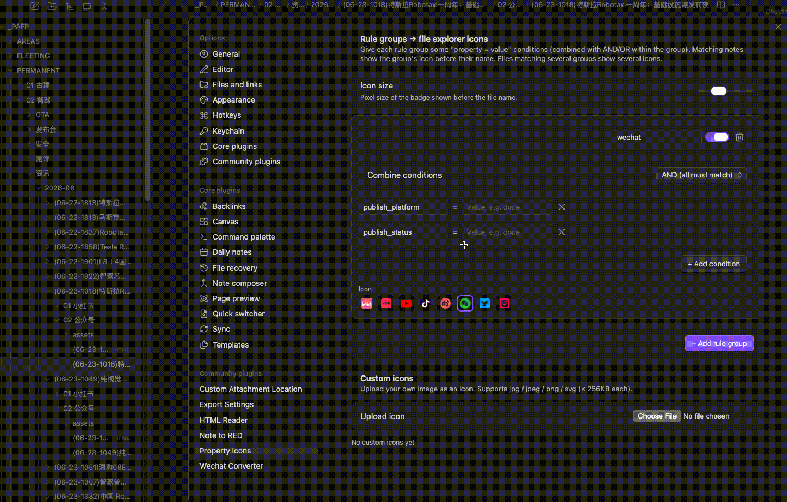

# Property Icons

**English** | [中文](README.zh-CN.md)

> Show badge icons before file names in Obsidian's file explorer, driven by note **property (frontmatter) rules**.

Your notes already carry their status in properties — `publish_status: done`, `publish_platform: wechat`, `priority: high`. **Property Icons** turns those into small icons in the file list, so you can see state at a glance without opening anything.



## Features

- **Rule groups** — create any number of rule groups. Each group is a set of `property = value` (exact) or `property contains value` (substring; arrays match by any element) conditions.
- **AND / OR per group** — choose whether *all* conditions must match (AND) or *any* (OR). One operator per group, kept simple.
- **Multiple icons** — a file that matches several groups shows several badges, in order.
- **Built-in brand icons** — bilibili, 小红书 (Xiaohongshu), YouTube, 抖音 (Douyin), 微博 (Weibo), WeChat, X, Instagram.
- **Custom icons** — upload your own image (`jpg` / `jpeg` / `png` / `svg`) and use it as a badge.
- **Live** — badges update instantly when a note's properties change, and survive file-tree scrolling/expanding.

## Usage

1. Enable the plugin, open **Settings → Property Icons**.
2. Click **+** in the **Rule groups** list — the new group opens in an edit dialog.
3. Add one or more conditions (e.g. property `publish_status`, value `done`), pick **且/或 (AND/OR)**, and choose an icon. Reorder or delete groups from the list.
4. Notes whose frontmatter matches now show the icon before their name in the file explorer.

Example — show the WeChat icon on notes synced to a WeChat draft:

```yaml
---
publish_platform: wechat
publish_status: done
---
```

Rule: `publish_platform = wechat` **AND** `publish_status = done` → WeChat icon.

## Notes on matching

- Conditions use **exact string equality** (`status: done` matches value `done`).
- If a property is a list (e.g. `tags: [a, b]`), the condition matches when **any** element equals the value.

## Trademark notice

The built-in icons are **simplified, brand-colored glyphs** created for this plugin to help you distinguish platforms at small sizes — they are **not** the official logos. All platform names and logos are trademarks of their respective owners, and their inclusion here does not imply any affiliation or endorsement. If you need an exact official logo, use the **custom icon upload** feature.

## Acknowledgements

This plugin was inspired by [Mark as Read / Explorer Property Attributes](https://github.com/hemy301/explorer-property-attributes) by **Maksim Volkov ([@hemy301](https://github.com/hemy301))** — the idea of surfacing note properties directly in the file explorer comes from his work. Property Icons is an independent implementation with its own rule-group engine and icon system, but it owes the original spark to that project. Thank you.

## Changelog

- v0.2.0 (2026-09-07): settings tab migrated to the Obsidian 1.13 declarative Settings API (`getSettingDefinitions`); rule groups are edited in a dialog and can be reordered by drag. Requires Obsidian ≥ 1.13.0.
- v0.1.x: initial releases (Obsidian ≥ 1.4.0).

## License

[MIT](LICENSE)
