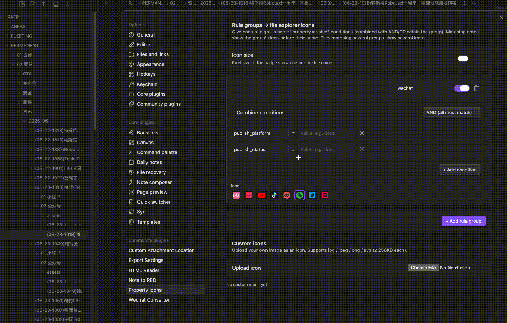

# Property Icons

[English](README.md) | **中文**

> 根据笔记的**属性（frontmatter）规则**，在 Obsidian 文件浏览器里给文件名前加上图标徽标。

你的笔记本来就把状态写在属性里 —— `publish_status: done`、`publish_platform: wechat`、`priority: high`。**Property Icons** 把这些状态变成文件列表里的小图标，不用打开笔记，一眼就能看到状态。



## 功能

- **规则组** —— 可创建任意多组规则，每组是一组「属性 = 值」（精确等于）或「属性 包含 值」（子串匹配；数组属性按任一元素判断）条件。
- **组内 且/或** —— 选择是**全部**条件都满足（且 / AND），还是**任一**满足（或 / OR）。一组只用一种，保持简单。
- **多个图标** —— 一个文件命中多组时，依次显示多个徽标。
- **内置品牌图标** —— bilibili、小红书、YouTube、抖音、快手、微博、知乎、微信、X、Instagram。
- **自定义图标** —— 上传自己的图片（`jpg` / `jpeg` / `png` / `svg`）作为徽标。
- **实时** —— 属性变化时徽标即时更新，文件树滚动/展开也不丢。

## 用法

1. 启用插件，打开 **设置 → Property Icons**。
2. 在 **规则组** 列表点 **+**，新规则组会在编辑弹窗中打开。
3. 添加一个或多个条件（例如属性 `publish_status`、值 `done`），选 **且/或**，再选一个图标。列表里可拖拽排序、删除规则组；点某一行的**复制**按钮，会在它正下方生成一份副本并打开编辑弹窗，改一两处即可得到相近的规则。
4. frontmatter 命中的笔记，就会在文件浏览器里的文件名前显示该图标。

示例 —— 给已同步到微信草稿的笔记显示微信图标：

```yaml
---
publish_platform: wechat
publish_status: done
---
```

规则：`publish_platform = wechat` **且** `publish_status = done` → 微信图标。

## 匹配说明

- 条件使用**精确字符串相等**（`status: done` 匹配值 `done`）。
- 若属性是列表（如 `tags: [a, b]`），只要**任一**元素等于该值即命中。

## 商标声明

内置图标是为本插件自绘的**简化品牌色字形**，用于在小尺寸下区分平台，**并非各平台官方 logo**。所有平台名称与标识均为其各自商标持有者所有，收录于此不代表任何关联或背书。如需精确的官方 logo，请使用**自定义图标上传**功能。

## 致谢

本插件受 **Maksim Volkov（[@hemy301](https://github.com/hemy301)）** 的 [Mark as Read / Explorer Property Attributes](https://github.com/hemy301/explorer-property-attributes) 启发 —— 「把笔记属性直接呈现到文件浏览器」这个思路来自他的作品。Property Icons 是拥有独立规则引擎与图标系统的独立实现，但最初的灵感源自那个项目。谢谢。

## 更新记录

- v0.2.1（2026-11-11）：规则组列表每行新增**复制**按钮，副本放在原规则组正下方并直接打开编辑；编辑弹窗在条件较多、可滚动时，添加条件 / 删除条件 / 选图标后不再跳回顶部；新建规则组的默认名称不再与已有名称重复；内置图标新增**快手**、**知乎**，X 图标换成新标志并跟随主题文字颜色。
- v0.2.0（2026-09-07）：设置页迁移到 Obsidian 1.13 声明式 Settings API（`getSettingDefinitions`）；规则组改为弹窗编辑，支持拖拽排序。最低 Obsidian 版本 1.13.0。
- v0.1.x：初始版本（Obsidian ≥ 1.4.0）。

## 许可协议

[MIT](LICENSE)
